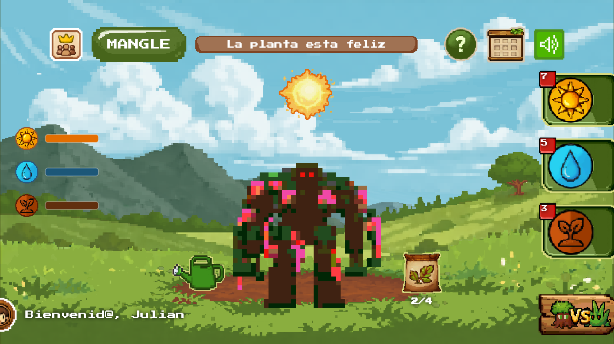
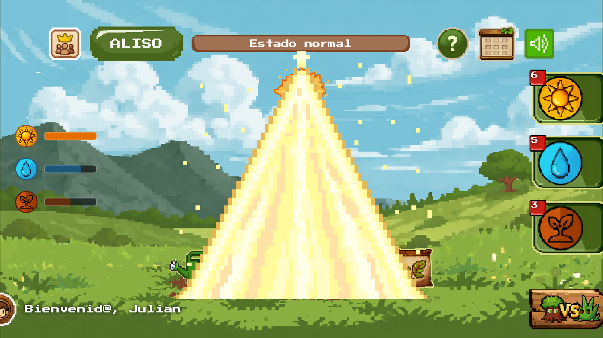
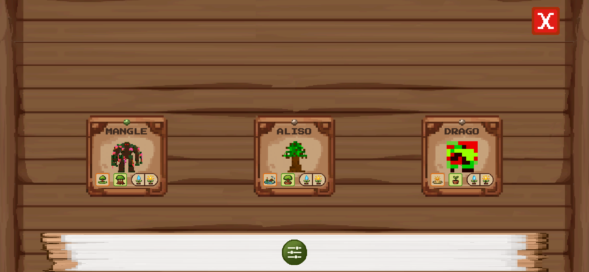
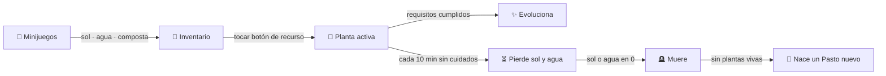

<div align="center">


# 🌱 Plant Imaginatio

**Cuida, haz crecer y colecciona plantas nativas en un juego pixel art para móvil.**

Juega minijuegos para conseguir sol, agua y composta, aplícalos a tu planta y
llévala de semilla a **ENT**. Tu jardín se sincroniza con un mundo 3D en Unity.




| ☀️ Aplicando sol | 🎒 Inventario |
|:---:|:---:|
|  |  |

</div>

---

## Contenido

- [Cómo se juega](#-cómo-se-juega)
- [Minijuegos](#-minijuegos)
- [Especies y evolución](#-especies-y-evolución)
- [Arquitectura](#️-arquitectura)
- [Sincronización con Unity (`.tree`)](#-sincronización-con-unity-tree)
- [Puesta en marcha](#-puesta-en-marcha)
- [Tests](#-tests)
- [Añadir arte nuevo](#-añadir-arte-nuevo)
- [Equipo](#-equipo)

---

## 🎮 Cómo se juega



1. **Inicia sesión** con tu nombre (sin contraseña; todo se guarda en el dispositivo).
2. **Juega minijuegos** para llenar el inventario. Cada uno tiene un tiempo de espera.
3. **Aplica recursos** con los botones de la derecha. Las barras de la izquierda muestran
   cuánto le falta a la planta para evolucionar.
4. **Evoluciona**: `semilla → arbusto → planta → ENT`. Al subir de fase los recursos
   vuelven al mínimo y empieza la siguiente etapa.
5. **No la descuides**: cada 10 minutos sin interacción pierde 1 de sol y 1 de agua.
   Las plantas ENT ya no se marchitan.
6. Desde el **inventario** puedes ver todas tus plantas, filtrarlas por tipo, fase o
   urgencia y elegir cuál cuidar.

| Estado en pantalla | Cuándo aparece |
|---|---|
| ✨ *La planta está feliz* | sol ≥ 8, agua ≥ 8 y fertilizante ≥ 5 |
| 🟡 *Necesita recursos* (partículas de peligro) | sol o agua ≤ 4 |
| 🔴 *Estado crítico* (partículas críticas) | sol o agua ≤ 2 |
| 🪦 *La planta murió* (lápida) | sol o agua llegan a 0 |

---

## 🎲 Minijuegos

| | Minijuego | Mecánica | Recompensa | Espera |
|---|---|---|---|---|
| ☀️ | **Sol** | 4 toques; cada uno puede subir de nivel: Bronce → Plata → Oro → Diamante → Solar | 1 a 5 soles | 10 min |
| 💧 | **Agua** | Toca la gota lo más rápido posible durante 5 s (meta: 50 toques) | 0, 2, 4 o 6 gotas | 10 min |
| 🍂 | **Composta** | En 5 s toca solo los residuos **orgánicos**; los inorgánicos restan | 0 a 4 de composta | 3 min |

> Cada **4 de composta se convierten automáticamente en 1 fertilizante**, que es el
> recurso que se aplica a la planta.

---

## 🌳 Especies y evolución

Cada especie pertenece a un tipo con necesidades distintas. Los valores son lo que
hay que aplicar en cada fase para evolucionar (y el máximo que admite esa fase):

| Tipo | Especies | Semilla ☀️/💧 | Arbusto ☀️/💧 | Planta ☀️/💧 |
|---|---|---|---|---|
| ☀️ Solar | Cajeto, Espino, Drago, Alcaparro | 6 / 2 | 8 / 4 | 10 / 6 |
| 🌵 Xerófito | Alcaparro enano, Dividivi | 4 / 2 | 6 / 4 | 8 / 6 |
| 🍃 Templado | Manzano, Mangle, Sietecueros, Cedro | 4 / 4 | 6 / 6 | 8 / 8 |
| ⛰️ Montaña | Roble, Pino romerón, Nogal, Duraznillo | 2 / 4 | 4 / 6 | 6 / 8 |
| 💧 Hidro | Aliso, Cedrillo, Cucharo | 2 / 6 | 4 / 8 | 6 / 10 |
| 🌾 Pasto | Pasto (planta inicial) | 3 / 3 | 5 / 5 | 7 / 7 |

Fertilizante requerido por fase (todos los tipos): **4 → 6 → 8**.

Las ilustraciones de las plantas fueron creadas por estudiantes: cada especie tiene
variantes (`Drago1` … `Drago7`, `Sietecueros1` … `Sietecueros13`, etc.) y el nombre
del autor aparece en el archivo de su fase ENT.

---

## 🏗️ Arquitectura

| Capa | Tecnología |
|---|---|
| UI y game loop | [Flutter](https://flutter.dev) + [Flame](https://flame-engine.org) |
| Estado | `ChangeNotifier` + [provider](https://pub.dev/packages/provider) |
| Navegación | [go_router](https://pub.dev/packages/go_router) |
| Audio | [flame_audio](https://pub.dev/packages/flame_audio) (`AudioPool` por efecto) |
| Persistencia | `SharedPreferences` + archivo `.tree` (JSON) compartido con Unity |
| Mundo 3D | Unity (proyecto aparte) |

```
frontend/lib/
├── main.dart                     # Arranque: audio, orientación, sesión y ruta inicial
├── core/
│   ├── audio.dart                # AudioManager: música y efectos
│   └── router.dart               # /login · /plant_game · /inventory
├── models/
│   ├── tree_models.dart          # Esquema del .tree v2 (TreeData, TreePlanta…)
│   ├── plant_catalog.dart        # Especie → tipo, nombre y sprite de cada fase
│   └── models.dart               # Usuario del login (legado)
├── services/
│   ├── tree_storage_service.dart         # .tree en SharedPreferences + merge con Unity
│   ├── shared_tree_storage_service.dart  # Export/import a Documents/IMAGINATIO
│   └── local_storage_service.dart        # Sesión y última interacción por planta
└── modules/
    ├── main_menu/                # Login
    ├── inventory/                # Colección de plantas con filtros
    └── plant_game/
        ├── plant_controller.dart # 🧠 Reglas del juego: recursos, evolución, decay, cooldowns
        ├── plant_screen.dart     # Pantalla principal (FlameGame)
        ├── components/           # Planta, botones, barras, efectos animados
        └── mini_games/           # sun/ · water/ · compost/ · sync/
```

**`PlantController`** es la única fuente de verdad del juego. Las pantallas se
suscriben a él y nunca modifican el `.tree` directamente:

```dart
final c = context.read<PlantController>();
c.addSun(3);                                  // premio de un minijuego
switch (c.spend(PlantResource.sol)) {         // aplicar a la planta activa
  case SpendResult.applied:   /* animación */
  case SpendResult.plantFull: /* "¡Lleno!" */
  case SpendResult.noStock:   /* "Sin stock" */
}
c.markPlayed(Minigame.sun);                   // inicia el cooldown
```

---

## 🔄 Sincronización con Unity (`.tree`)

El progreso vive en un JSON llamado `.tree` que Flutter y Unity comparten a través de
`Documents/IMAGINATIO/Data_user.tree`. Cada aplicación solo escribe sus propios campos:

| 🟢 Escribe Flutter | 🔴 Escribe Unity |
|---|---|
| `usuario.id`, `usuario.nombre` | `usuario.nivel`, `usuario.xp` |
| `recursos.*` (sol, agua, composta, fertilizante) | `planta.estado.salud`, `hp_actual` |
| `planta.estado.fase` | `planta.progreso.*`, `planta.uso.*` |
| `planta.recursos_aplicados.*` | `semillas.*` |

- Cada cambio se guarda en `SharedPreferences` y se exporta al archivo compartido
  (si hay permiso de acceso a archivos).
- El botón **3D** abre el panel de sincronización: exporta el `.tree` para Unity o
  importa los cambios de Unity conservando los campos de Flutter.
- Antes de importar se crea una copia de seguridad.

---

## 🚀 Puesta en marcha

Requisitos: **Flutter 3.41+** (Dart 3.11) y Android SDK.

```bash
cd frontend
flutter pub get
flutter run                 # en un dispositivo o emulador Android (horizontal)
```

```bash
flutter build apk --release # APK de producción
flutter analyze             # análisis estático
```

> En modo debug aparece un botón rojo **T** arriba a la derecha que adelanta 10 minutos
> (decay y cooldowns) para probar sin esperar. En el login hay un botón
> **🔧 Debug Reset** que borra la partida.

---

## 🧪 Tests

```bash
cd frontend
flutter test
```

| Archivo | Qué cubre |
|---|---|
| `plant_controller_test.dart` | Aplicar recursos, capacidad por fase, evolución, composta → fertilizante, decay y muerte, cooldowns, guardado y carga |
| `plant_catalog_test.dart` | Clasificación de especies y resolución de sprites (variantes, archivos con autor, fallback a Pasto) |
| `minigame_logic_test.dart` | Recompensas de los minijuegos de sol, agua y composta |
| `effect_sheets_test.dart` | Que cada animación y cada planta coincide con el formato de su sprite sheet y no supera 4096 px |

---

## 🎨 Añadir arte nuevo

**Una planta nueva o una variante**

1. Crea `frontend/assets/images/Planta/<Especie><N>/` con `fase1_ss.png` … `fase4_ss.png`:
   18 frames de 500×500 en una **cuadrícula de 6 columnas × 3 filas** (3000×1500 px).
   La fase 4 puede llevar el autor delante: `Especie_Nombre_Apellido_fase4_ss.png`.
2. Añade la carpeta a la lista de `assets` de `pubspec.yaml` (Flutter no incluye
   subcarpetas automáticamente).
3. Si es una especie nueva, regístrala en `lib/models/plant_catalog.dart` con su tipo.

**Una animación de efecto**

Empaqueta los frames de 500×500 en una cuadrícula de **8 columnas** (máximo 4000 px de
ancho) y añade una entrada en `GameEffect` (`components/effect_animation.dart`).

> ⚠️ **No uses sheets de una sola fila.** Muchas GPUs móviles no cargan texturas de más
> de 8192 px y el sprite simplemente no aparece. `flutter test` lo comprueba.

---

## 👥 Equipo

Proyecto colaborativo de desarrollo móvil, 3D e ilustración.

- **Flutter** — app móvil, minijuegos y lógica del juego
- **Unity** — mundo 3D que lee y escribe el mismo `.tree`
- **Arte** — escenarios, interfaz y plantas pixel art hechas por estudiantes

> El antiguo backend en FastAPI está retirado: el juego funciona sin servidor.
